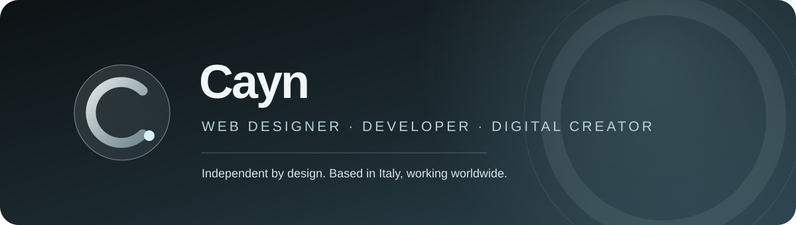

<div align="center">
  
</div>

<div align="center">
  
  <br />
  <a href="https://www.cayn.dev"></a>
  <a href="mailto:jacopo.dev0@gmail.com"></a>
  
</div>

<br />

## Hey, I'm Jacopo — Cayn

I'm an independent web designer and developer based in Italy. I work with small businesses, founders and professionals to turn ideas into clear, distinctive digital experiences.

I take projects from the first conversation through design, development and launch. That means you work directly with the person shaping the details and building the final product.

**Websites · Landing pages · UI/UX · Web apps · Digital tools**

---

## Selected work

### [Cashow ↗](https://cashow.lovable.app)
**Personal finance app**

A finance app designed to help people track expenses, understand their spending habits, manage budgets and build better financial awareness. The dashboard brings balances, budgets and trends together so the important information is easy to read at a glance.

`Product design` `Web app` `Personal finance`

### [Agriturismo Occhiominno ↗](https://www.agriturismocchiominno.com)
**Website for a family-run agriturismo in Puglia**

A professional website for a Puglian agriturismo, with search-friendly structure, an olive-oil catalogue, booking and order enquiries, and a responsive experience built for guests on every device.

`Business website` `SEO` `Local business`

### [Cayn.dev ↗](https://www.cayn.dev)
**My portfolio and independent practice**

The place to explore my work, services and approach. Designed and built to feel considered, move smoothly and stay usable across devices, with lighter motion options for mobile and lower-powered computers.

`Portfolio` `Web design` `Interaction`

---

## What I do

| Service | What it can include |
| --- | --- |
| **Business websites** | Pages, content structure, catalogues, contact forms, local SEO and responsive implementation. |
| **Landing pages** | A focused page for a launch, campaign, service or single conversion goal. |
| **UI/UX design** | Interface structure, interaction design and a visual system tailored to the product. |
| **Website redesign** | A clearer, faster, mobile-friendly experience that keeps useful existing content and URLs in mind. |
| **Web apps & digital tools** | Custom interfaces and product experiences for needs that go beyond a standard website. |

## How I work

1. **Discover** — understand the business, audience and outcome the project needs to support.
2. **Design** — shape the content, structure and visual direction around those goals.
3. **Build** — develop the experience with attention to responsive layouts, performance and details.
4. **Launch** — review together, publish and make sure you know how to move forward.

## Tools I use

<div align="center">
  
  
  
  
  
  
  
  
  
  
</div>

I also use **Spline** for selected 3D elements and **Lovable** to explore and ship product ideas.

---

## GitHub

<div align="center">
  
  
</div>

<div align="center">
  
</div>

---

## Say hello

Have a project, a question or an idea you'd like to make real? [Send me an email](mailto:jacopo.dev0@gmail.com) or visit [cayn.dev](https://www.cayn.dev). I read every message myself.

<div align="center">
  
</div>

---

## About this repository

This repository brings together my public profile presentation and the source for [cayn.dev](https://www.cayn.dev). The portfolio is a static HTML, CSS and JavaScript site and is ready to deploy on Vercel without a package install or build step.

```text
index.html          portfolio site
styles.css          base design system and layout
scroll.css          page transitions, scroll reveals and responsive styling
scroll.js           navigation, interactions, theme and lightweight modes
assets/             Cayn identity and project imagery
fonts/              local font files and license information
docs/WEBSITE.md     site contents and deployment notes
```

This repository is intentionally kept focused on the finished portfolio: its source, visual assets, fonts and deployment configuration are all included here.
