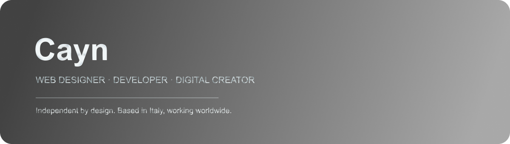

  

  
  
  

 

<strong>From the first sketch to the finished site.</strong>

## About me

### Hey, I’m Jacopo — Cayn

I’m an independent web designer and developer based in Italy. I work with small businesses, founders and professionals to turn ideas into clear, useful websites and digital products.

I can help from the first conversation to launch, working directly with you on the design, development and details along the way.

**Websites · Landing pages · UI/UX · Web apps · Digital tools**

## Selected work

### [Cashow](https://cashow.lovable.app)

**Personal finance app**

Cashow helps people keep track of their spending and budgets. It brings balances and spending trends together in one clear dashboard.

### [Agriturismo Occhiomino](https://www.agriturismocchiominno.com)

**Website for a family-run agriturismo in Puglia**

A website for a family-run agriturismo in Puglia, with information about the property, an olive oil catalogue and ways to ask about bookings and orders.

### [Cayn.dev](https://www.cayn.dev)

**My portfolio and independent practice**

My portfolio, where you can see my work, services and how I approach projects. I designed it to be easy to use on different devices, with lighter animations for mobile and less powerful computers.

## What I do

| Service | What it can include |
| --- | --- |
| **Business websites** | Pages, content structure, contact forms and a layout that works on mobile. |
| **Landing pages** | A focused page for a product, service, campaign or launch. |
| **UI/UX design** | Clear layouts and interactions shaped around the people using the product. |
| **Website redesign** | A more current, easier-to-use site that keeps useful content and existing links. |
| **Web apps & digital tools** | Custom interfaces for ideas that need more than a standard website. |

## How I work

1. **Understand** — We talk through your goals, audience and what the project needs to do.
2. **Plan** — I shape the content, structure and visual direction.
3. **Build** — I develop the site or product, paying attention to mobile, speed and detail.
4. **Launch** — We review everything together and get it ready to go live.

## Tools I use

  
  
  
  
  
  
  
  
  
  

I also use **Spline** for selected 3D elements and **Lovable** to explore ideas for digital products.

## Say hello

Have a project in mind, or just want to ask a question? [Send me an email](mailto:jacopo.dev0@gmail.com) or visit [cayn.dev](https://cayn.dev). I read every message myself.
